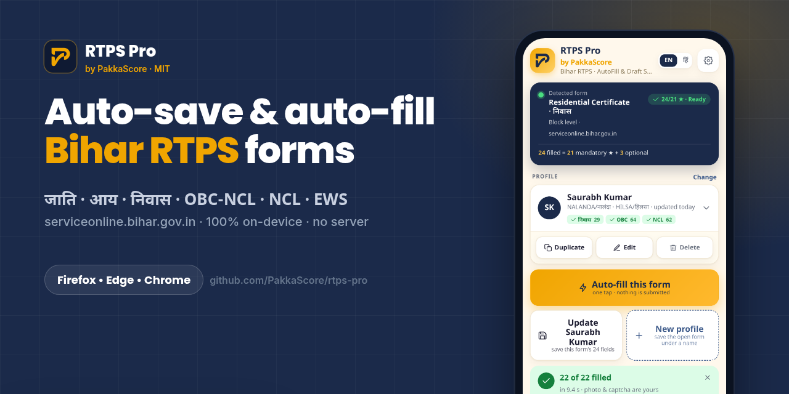
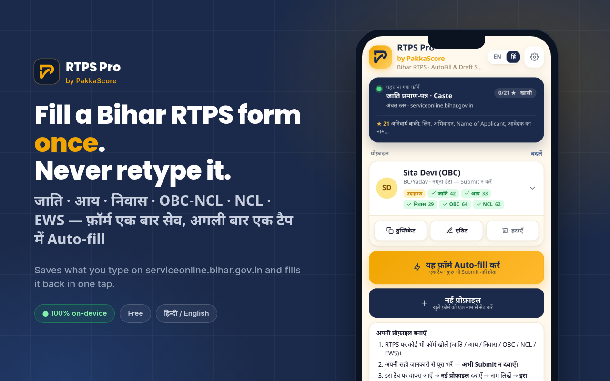
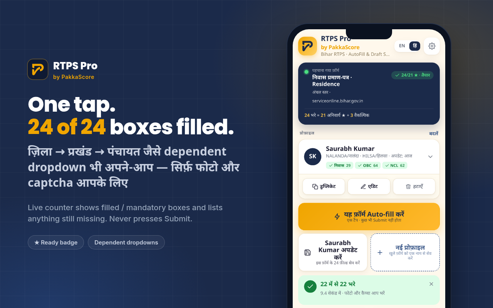
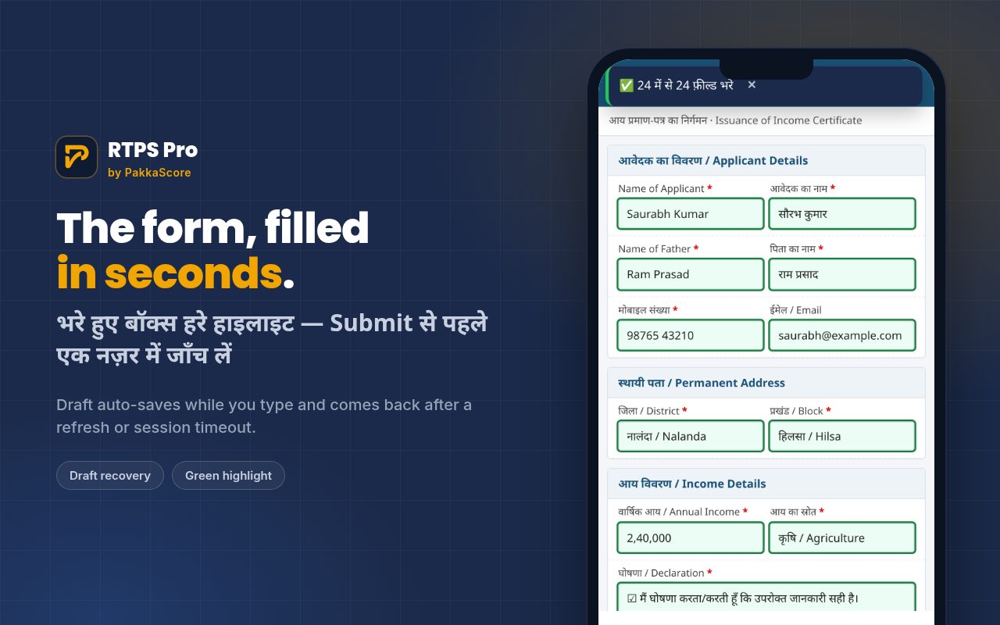
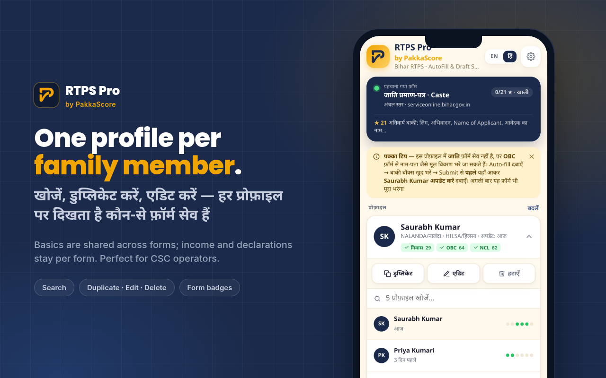
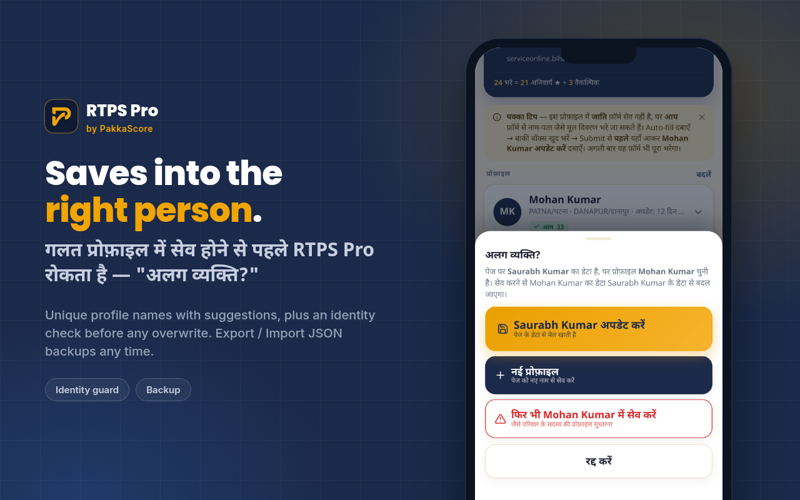
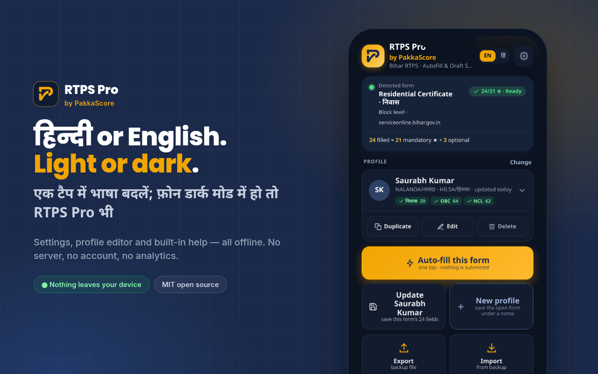

  

<h1 align="center">RTPS Pro by PakkaScore</h1>

<b>Bihar RTPS form — save once, fill in one tap.</b> जाति, आय, निवास, OBC-NCL, NCL, EWS — वही नाम, पता, जिला बार-बार? RTPS Pro एक बार सेव करता है, अगली बार एक टैप में भर देता है।

  
  
  
  
  

  <a href="https://pakkascore.github.io/rtps-pro/"><b>pakkascore.github.io/rtps-pro</b></a> •
  <a href="https://pakkascore.github.io/rtps-pro/guide-hi.html">हिन्दी गाइड</a> •
  <a href="https://pakkascore.github.io/rtps-pro/guide-en.html">English Guide</a>

---

## Why RTPS Pro?

Bihar RTPS portal (serviceonline.bihar.gov.in) asks for the same 20-30 fields for every certificate — name, father's name, mother's name, address, caste, district → block → panchayat chain, police station. Need 3 certificates? Fill 3 times. Family of 4? 12 times. Session timeout? Start again.

**RTPS Pro ends this.** Fill any supported form once, save as a named profile, and auto-fill any future form in one tap — including cascading dropdowns.

**6 Block-level (RO) forms supported:**

| Form | Hindi | Use Case |
|------|-------|----------|
| Caste Certificate | जाति प्रमाण-पत्र | School admission, reservation |
| Income Certificate | आय प्रमाण-पत्र | Scholarship, ration, welfare |
| Residence Certificate | निवास प्रमाण-पत्र | Domicile for jobs/admissions |
| OBC-NCL (Form-VI) | OBC-NCL केंद्र | Central govt jobs: UPSC, SSC, Railways |
| NCL (Form-IX) | NCL बिहार | Bihar state jobs: BPSC |
| EWS Certificate | EWS प्रमाण-पत्र | EWS quota |

---

## Install — Firefox • Edge • Chrome

| Browser | Platform | How | Auto-update |
|---------|----------|-----|-------------|
| **🦊 Firefox** ⭐ Recommended | Android + Windows / Mac / Linux | [**Add to Firefox**](https://addons.mozilla.org/firefox/addon/rtps-pro/) | ✅ |
| **🌊 Edge** | Android + Windows / Mac | [**Get from Edge Add-ons**](https://microsoftedge.microsoft.com/addons/detail/gdicmdfikcnmgajipklnfmkjfcdmlbki) | ✅ |
| **🌐 Chrome** | Desktop only | [rtps-pro.zip](https://github.com/PakkaScore/rtps-pro/releases/latest/download/rtps-pro.zip) → `chrome://extensions` → Developer mode → Load unpacked | manual |

**Why Firefox Recommended?** Desktop Chrome/Edge sometimes show `NET::ERR_CERT_AUTHORITY_INVALID` on RTPS portal; Firefox opens it fine. RTPS portal's own compatible browsers note recommends Firefox. On Android, Firefox & Edge are the only browsers with official extension support.

Other Android browsers (Quetta / Kiwi) — from zip

[Quetta](https://play.google.com/store/apps/details?id=net.quetta.browser) (Play Store) or [Kiwi](https://github.com/kiwibrowser/src.next/releases) — download `rtps-pro.zip` → menu → Extensions → Developer mode → + from .zip → pick zip. No auto-update — re-add new zip (profiles kept). Official: Firefox / Edge.

---

## How to Use — 3 Steps

1. **Fill once, save before Submit** — Open any RTPS form on serviceonline.bihar.gov.in, fill it, then **before Submit** → RTPS Pro → New profile → name → Save from this form → then Submit.
2. **One-tap next time** — Open any form → pick profile → Auto-fill. Only photo, captcha, declaration left.
3. **Multiple profiles** — One per family member/client. Search, Duplicate, Edit, Delete from profile card.

2 example profiles included (Sita Devi OBC, Rahul Sharma EWS, Aadhaar `0000 1111 2222`) to try without saving — never Submit them.

---

## Features — 12 Highlights

- ⚡ **One-tap auto-fill** — 20-30 boxes in seconds, cascading State→District→Block→Panchayat via MutationObserver
- 👥 **Multiple profiles + search** — per family/client, form badges, Duplicate•Edit•Delete
- 📊 **Live fill counter** — `24 filled • 21 required` near action, green ★ when all required done
- 💾 **Draft recovery** — auto-saves as you type, restore after refresh/timeout, kept 7 days
- 🛡️ **Identity guard** — compares applicant name on page vs profile, asks "Different person?" needs double-tap to override
- 💡 **Pakka Tip — borrow basics** — Residence saved but Income opened? Borrows basics, you add income-specific once → Update
- 📋 **Duplicate • Edit • Delete** — Duplicate copies basics, Edit updates, Delete armed double-tap (Android safe)
- 🔒 **100% on-device** — no server, no account, no analytics, only `serviceonline.bihar.gov.in` permission
- 🔄 **Export / Import JSON** — one or all profiles, backup, transfer
- 🌐 **Firefox • Edge • Chrome** — Firefox recommended, Android via official stores
- 🌓 **Hindi default, English toggle, auto dark mode, mobile-first**
- ⚙️ **Shortcuts** — `Alt+Shift+F` fill, `Alt+Shift+S` save, right-click menu

---

## Screenshots

  
  
  

  
  
  

Full guides with 12 screens each: [Hindi Guide](https://pakkascore.github.io/rtps-pro/guide-hi.html) • [English Guide](https://pakkascore.github.io/rtps-pro/guide-en.html)

---

## Privacy

100% on-device. Profiles, drafts, settings in `chrome.storage.local` only. No server, no account, no analytics, no remote code, no network requests. Permissions: `storage`, `activeTab`, `scripting`, `contextMenus`, `tabs`; host `https://serviceonline.bihar.gov.in/*`. Uninstall removes everything.

> **✅ Always FREE.** RTPS Pro never asks for money. Official only on Firefox Add-ons (by PakkaScore), Edge Add-ons, and this GitHub repo. If someone demands payment, it's fake — report it.

**Disclaimer:** Independent tool by PakkaScore. Not affiliated, endorsed, or sponsored by Govt of Bihar, NIC, RTPS/ServicePlus. Always verify form before Submit.

---

MIT License • © 2026 PakkaScore — Built with ❤️ for Bihar
